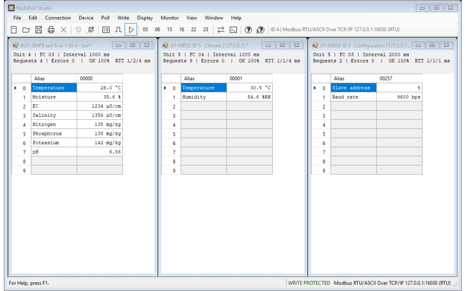

# MultiPoll Studio

Previously developed under the working name OpenPoll. The product is now **MultiPoll Studio**.
Repository folder names and dated research briefs retain their original names.

Open-source Modbus master for testing and commissioning RS-485 / Modbus TCP devices.

| Folder | What |
|---|---|
| `openpoll-win/` | Native Windows edition: one ~350 KiB EXE (C# WinForms, .NET Framework 4.8 built into Windows 10/11), no installer. Most features. |
| `openpoll/` | Cross-platform Python edition (PySide6 GUI + `multipoll-studio` CLI). Fewer features (see its README). |
| `re/` | `REPORT.md` and `tools/`: notes from a static study of a commercial Modbus master, used as a behaviour reference. The studied files themselves are not part of this repository. |
| `outputs/` | Research briefs that chose the roadmap (sources cited inside). |

## Features

The Windows edition includes:

- **Connections:** serial Modbus RTU/ASCII, Modbus TCP, Modbus UDP, and RTU/ASCII over TCP/UDP. Each polling
  window can use the main connection or its own port/host; windows sharing a port share a worker.
- **Read and write:** FC01–04 reads; FC05, FC06, FC15, FC16, FC22 and FC23 write or read/write dialogs.
  The toolbar follows the active window's unit ID and connection; its function buttons open dialogs rather
  than sending immediately.
- **Device commissioning:** ten built-in JSON profiles, Device Settings, read-only Find Device, unit-ID scan,
  and diagnostics with read-only configuration fixes. Profiles indicate unverified facts; check your device manual.
- **Interpretation:** register aliases, engineering scale and units, multiple data types and byte orders,
  tag-map CSV import/export, and an Interpret As panel.
- **Monitoring:** traffic and raw-frame consoles, per-window counters and response times, alarms, trend graphs,
  and CSV/TSV logging with rotation and optional deadband.
- **Write safeguards:** local write protection, optional confirmation, and a hash-chained audit log. These are
  operator safeguards, **not authentication or an access-control boundary**.
- **Files:** `.mpoll` documents and `.mpollw` workspaces. Frame Console lists use the header
  `MultiPoll Studio Frame List`; old lists need their first line changed after creating a backup.

The Python edition includes serial/network communication, polling, write dialogs, formats, logging and a CLI,
but does not yet have all Windows features, including the native toolbar, device profiles and multi-connection UI.
See the [Windows guide](openpoll-win/README.md), [Python guide](openpoll/README.md), and
[Windows changelog](openpoll-win/CHANGELOG.md) for details.

## Safety

Modbus does not provide authentication or encryption by itself. Use the application only on networks and
equipment you are authorized to test. Enable write protection when observing live devices; validate unit ID,
connection, function, address and value before any write. Scanning sends read requests to multiple addresses
and should be scheduled appropriately for operational equipment. Simulator screenshots do not establish that
a particular physical device supports a profile or setting.

## Demo and screenshots

The following captures were made with simulated Modbus devices, not a production installation.
The GIF is a **slideshow of screenshots**, not a recording of live interaction. The screenshots show
the redesigned MultiPoll Studio interface exercised with the simulator.



| Feature | Screenshot | What it shows |
|---|---|---|
| Multi-device and toolbar | [Multi-device view](assets/screenshots/multi-device.png) | Separate BGT-SMPS ID 4 and XY-MD02 ID 5 windows, register names and engineering units, active-target toolbar, and write-protection indicator. |
| Find Device | [Read-only search](assets/screenshots/find-device.png) | Baud/parity/ID scan against the simulator; exception replies are shown separately from returned data. |
| Device Settings | [Settings dialog](assets/screenshots/device-settings.png) | Simulated ADM-4204V ID, baud, parity and configuration options. Writes require the application safeguards and should be used only on authorized equipment. |
| Diagnosis | [Diagnosis dialog](assets/screenshots/diagnosis.png) | An illegal-function response, explanation, and a read-only switch to FC03. |
| Display formats | [Format picker](assets/screenshots/display-format.png) and [poll windows](assets/screenshots/data-types.png) | String length and byte order; several polling windows with independent status. |
| Trend | [Trend chart](assets/screenshots/trend.png) | Two time-series with pause and CSV/PNG export controls. |
| Communication | [Traffic monitor](assets/screenshots/traffic.png) | Sent and received Modbus frames with stop, copy and save controls. |
| Frame Console | [Raw-frame console](assets/screenshots/frame-console.png) | A request and response against the simulator, with CRC/LRC options and list controls. |

The GIF and screenshots do not cover every application feature; see the Windows feature list and usage details in
[`openpoll-win/README.md`](openpoll-win/README.md).

## Build and try it

**Windows edition:** from WSL, with Visual Studio's Roslyn compiler and Python 3 available:

```sh
cd openpoll-win
./build.sh                 # produces dist/MultiPollStudio.exe
python3 tools/device_sim.py --host 127.0.0.1 --port 5030
```

Run the built EXE from a local Windows folder. In a separate window, connect to `127.0.0.1:5030`
using RTU over TCP; the simulator also provides Modbus TCP on port `5031`. Its devices are simulations.
The executable requires .NET Framework 4.8. Build details and simulator limitations are in the
[Windows guide](openpoll-win/README.md).

**Python edition:** from the repository root, in an existing Python environment:

```sh
cd openpoll
python -m pip install -e '.[gui,test]'
python -m pytest
multipoll-studio
```

The Python GUI needs PySide6; the core/CLI also needs pyserial. For example, a read from the simulator's
Modbus TCP endpoint is `multipoll-studio read --tcp 127.0.0.1 -p 5031 -s 5 -f 4 -a 1 -n 2`.

## Compatibility and provenance

The Windows and Python editions use the same `.mpoll` / `.mpollw` document identifiers, but the Python
edition does not support every Windows-specific display format or feature. Previous OpenPoll settings and
file identifiers are not imported automatically. See [NOTICE.md](NOTICE.md) for development history,
trademarks and device profile provenance; the static research does not constitute legal clearance.

## License and contribution

GPL-3.0-or-later: see [LICENSE](LICENSE). Contributions: [CONTRIBUTING.md](CONTRIBUTING.md) and
[CODE_OF_CONDUCT.md](CODE_OF_CONDUCT.md). For vulnerability reporting, see [SECURITY.md](SECURITY.md).
