# MultiPoll Studio

Previously developed under the working name OpenPoll. The product is now **MultiPoll Studio**.
Repository folder names and dated research briefs retain their original names.

Open-source Modbus master for testing and commissioning RS-485 / Modbus TCP devices.

| Folder | What |
|---|---|
| `openpoll-win/` | Native Windows edition: one ~350 KiB EXE (C# WinForms, .NET Framework 4.8 built into Windows 10/11), no installer. Most features. |
| `openpoll/` | Cross-platform Python edition (PySide6 GUI + `multipoll-studio` CLI). Fewer features (see its README). |
| `re/` | `REPORT.md` and `tools/`: notes from a static study of a commercial Modbus master, used as a behaviour reference. The studied files themselves are not part of this repository. |
| `outputs/` | Research briefs that chose the roadmap (sources cited inside). |

## Download for Windows

[Download MultiPoll Studio v0.5.1](https://github.com/Wayan123/multipoll-studio/releases/tag/v0.5.1).
Choose `MultiPollStudio-0.5.1-windows.zip` for the EXE, license and notices, or download
`MultiPollStudio.exe` directly. Extract the ZIP into a local folder and run the EXE; no installer is required.
The Windows build requires .NET Framework 4.8. The Python edition remains available as source.

**Windows signing warning:** this EXE is not Authenticode-signed. Windows may show an unknown-publisher or
SmartScreen warning, or block execution under security policy. Do not disable Windows protections to run it.
The release includes SHA-256 checksums and a separate SSH signature; neither is a Windows code-signing certificate.
See the [release notes and verification instructions](docs/releases/v0.5.1.md).

## Features

The Windows edition includes:

- **Connections:** serial Modbus RTU/ASCII, Modbus TCP, Modbus UDP, and RTU/ASCII over TCP/UDP. Each polling
  window can use the main connection or its own port/host; windows sharing a port share a worker.
- **Read and write:** FC01–04 reads; FC05, FC06, FC15, FC16, FC22 and FC23 write or read/write dialogs.
  The toolbar follows the active window's unit ID and connection; its function buttons open dialogs rather
  than sending immediately.
- **Device commissioning:** ten built-in JSON profiles, Device Settings, read-only Find Device, unit-ID scan,
  and diagnostics with read-only configuration fixes. Profiles indicate unverified facts; check your device manual.
- **Interpretation:** register aliases, engineering scale and units, multiple data types and byte orders,
  tag-map CSV import/export, and an Interpret As panel.
- **Monitoring:** traffic and raw-frame consoles, per-window counters and response times, alarms, trend graphs,
  and CSV/TSV logging with rotation and optional deadband.
- **Write safeguards:** local write protection, optional confirmation, and a hash-chained audit log. These are
  operator safeguards, **not authentication or an access-control boundary**.
- **Files:** `.mpoll` documents and `.mpollw` workspaces. Frame Console lists use the header
  `MultiPoll Studio Frame List`; old lists need their first line changed after creating a backup.

The Python edition includes serial/network communication, polling, write dialogs, formats, logging and a CLI,
but does not yet have all Windows features, including the native toolbar, device profiles and multi-connection UI.
See the [Windows guide](openpoll-win/README.md), [Python guide](openpoll/README.md), and
[Windows changelog](openpoll-win/CHANGELOG.md) for details.

## Safety

Modbus does not provide authentication or encryption by itself. Use the application only on networks and
equipment you are authorized to test. Enable write protection when observing live devices; validate unit ID,
connection, function, address and value before any write. Scanning sends read requests to multiple addresses
and should be scheduled appropriately for operational equipment. Simulator screenshots do not establish that
a particular physical device supports a profile or setting.

## Demo and screenshots

These screenshots show the real Windows application's forms rendered by its in-process GUI smoke runner
(`DrawToBitmap`) against simulated Modbus devices, not a production installation. The v0.5.1 capture runner
uses a unique registry key and output directory. The GIF below is an older **slideshow of screenshots**,
not a recording of live interaction. Screenshots illustrate controls and state; the release notes record executed checks.


### Multi-device polling and toolbar

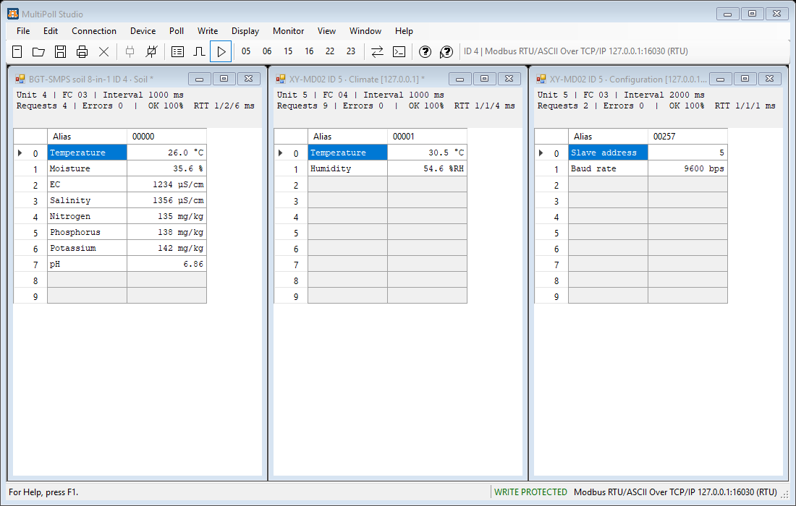

The three windows show a BGT-SMPS soil block and XY-MD02 climate and configuration blocks. Each has its own
unit, function, interval, request/error counters and response times. Profile names, scaling and units make raw
registers easier to interpret. The toolbar label identifies the active target; its connect and disconnect
commands affect that connection, including any other windows sharing it. The status bar shows write protection.

### Find Device

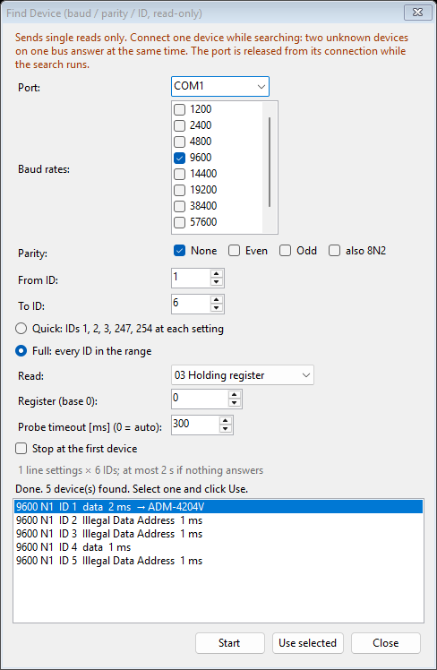

Find Device searches selected baud rates, parity settings and unit IDs using single read requests. This example
shows a full ID range, a selected holding-register read, and results that distinguish data from exception
replies. **Use selected** applies the selected baud, parity and ID. The dialog warns that the port is released
from its connection during the search and recommends connecting one device while searching.

### Device Settings

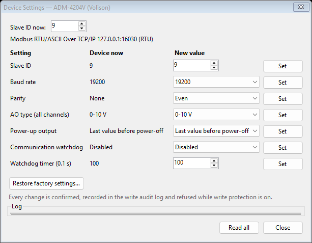

The dialog compares current values with proposed values for the simulated ADM-4204V, including unit ID, baud,
parity and output/watchdog settings. **Read all** refreshes settings; each **Set** button applies its setting.
These operations can write to a device: changes are confirmed and audited, and refused while write protection
is on. Check the device manual and profile provenance before changing real equipment.

### Diagnosis

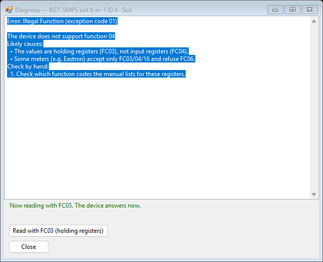

The simulated device rejected an FC04 read with an illegal-function exception. The dialog suggests checking the
manual and offers a switch to FC03 holding registers; the displayed status reports that the device then answered.
Diagnosis fixes change the application's read configuration rather than writing settings to the device.

### Display formats and polling status

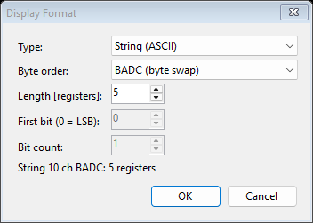

The format picker configures how registers are interpreted. Here a five-register ASCII string uses BADC byte
order. Other available formats include numeric types and bit fields; the controls shown depend on the chosen type.

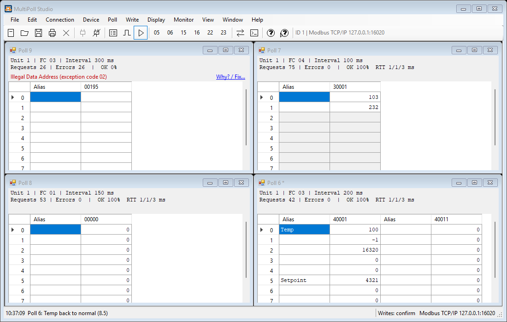

These polling windows show different read functions and intervals, aliases, address styles, values and independent
status counters. One reports an illegal-data-address exception and offers **Why? / Fix…**; the image does not
show every available display type.

### Trend

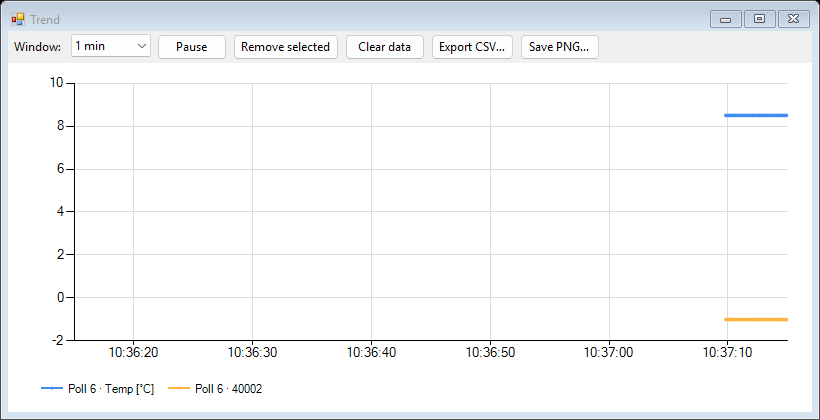

The chart displays two selected values over a one-minute window. Its controls pause the display, remove a series,
clear data and export CSV or PNG. The Windows edition supports up to 12 values from different polling windows;
failed polls appear as gaps.

### Communication traffic

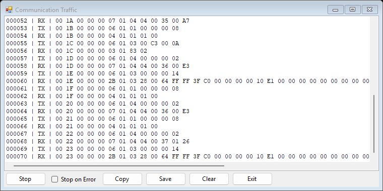

The traffic monitor lists sequence numbers, TX/RX direction and hexadecimal frame bytes across connections.
The capture shows controls to stop, copy, save or clear the list and an option to stop on error.

### Frame Console

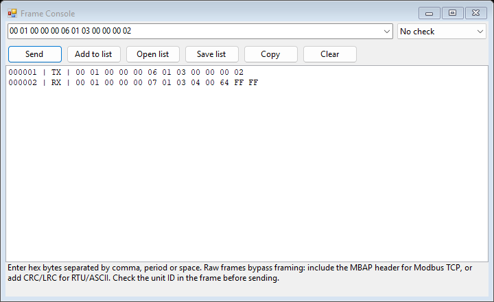

Frame Console sends explicitly entered hexadecimal frames and displays transmitted and received bytes. This
example uses a Modbus TCP request with **No check** selected. Raw frames bypass normal framing: include the MBAP
header for Modbus TCP, or use the appropriate CRC/LRC for RTU/ASCII, and check the unit ID before sending.
Write protection also applies to frames that are not known reads.

### Connection and Poll Setup

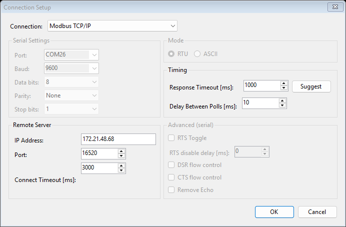

**Connection Setup** chooses the transport, remote server and timing. This run uses Modbus TCP on a test
endpoint. The serial controls are disabled here: the visible COM26 selection was not opened or used.
For serial operation choose the correct COM port, baud, parity and framing from the device manual.

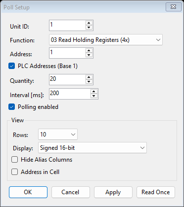

**Poll Setup** defines unit ID, function, address, quantity and interval independently for each window.
The screenshot uses FC03, 20 registers and a 200 ms interval. **PLC Addresses (Base 1)** changes the displayed
address convention; check it before entering an address. **Read Once** requests one sample, while
**Polling enabled** controls repeated reads.

### Device profiles

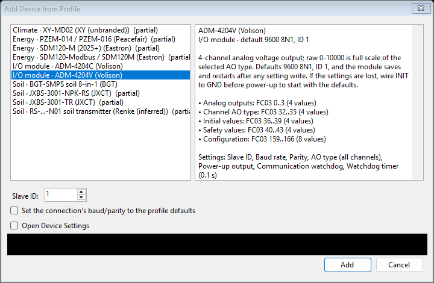

Select a profile and unit ID to open named register blocks with the profile's types, scaling and units.
The list identifies partial profiles; inspect their sources before relying on them. This example selects
the ADM-4204V. The local profile-directory row is masked for privacy, not replaced with invented UI.

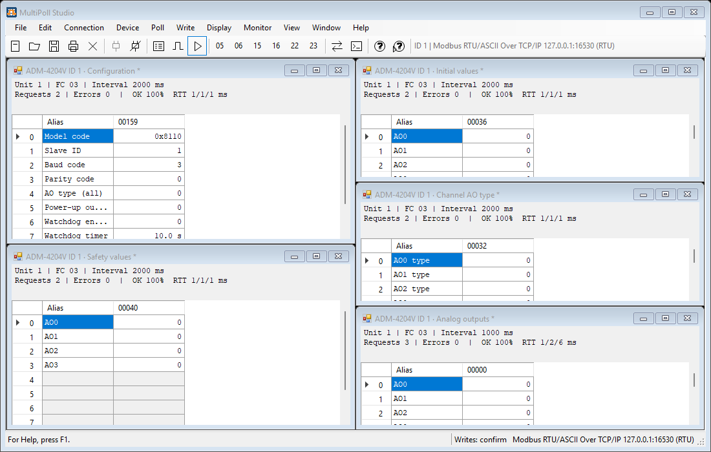

The profile opens separate output, channel-type, initial-value, safety-value and configuration windows.
Opening these windows reads data; changing a setting or writing an output is a separate operation.

### Modbus write dialogs

The following examples **wrote only to the simulator** and show the dialogs after `Response ok`.
Before writing to equipment, check unit ID, connection, base-address convention and values.
Write protection refuses writes locally; confirmation and audit settings remain operator safeguards, not authentication.

<details>
<summary>FC05: write one coil</summary>

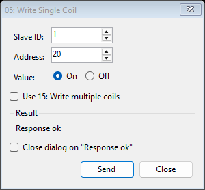

Set one Boolean output. The example turns coil address 20 on. Selecting the FC15 option uses the multiple-coil function.

</details>

<details>
<summary>FC06: write one register</summary>

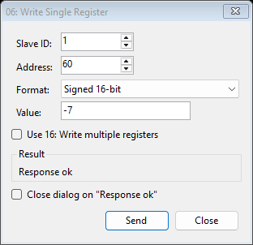

Choose the register's display format, then enter its value. This example writes signed 16-bit `-7` at protocol address 60.

</details>

<details>
<summary>FC15: write multiple coils</summary>

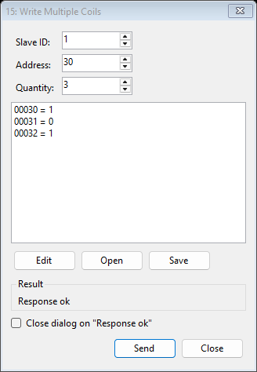

Edit a contiguous list of Boolean values. The example writes `1, 0, 1` starting at protocol address 30.
The list can also be opened from or saved to a file.

</details>

<details>
<summary>FC16: write multiple registers</summary>

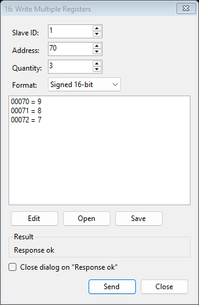

The example writes `9, 8, 7` starting at protocol address 70. Quantity determines the contiguous block.
Check both the chosen format and byte order when values occupy multiple registers.

</details>

<details>
<summary>Multi-register floating-point write</summary>

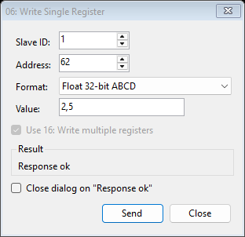

The single-value editor uses FC16 when a value spans multiple registers. Here Float32 ABCD writes `2.5`
(entered as `2,5`) at protocol address 62; the FC16 option is selected automatically.

</details>

<details>
<summary>FC22: mask write register</summary>

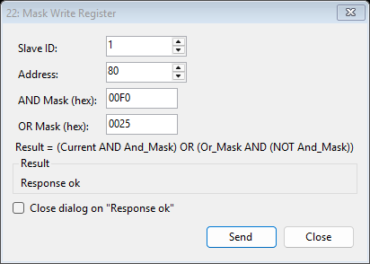

Apply hexadecimal AND and OR masks to one register. The example uses address 80, AND mask `00F0`
and OR mask `0025`; the dialog displays the Modbus mask-write formula.

</details>

<details>
<summary>FC23: read and write multiple registers</summary>

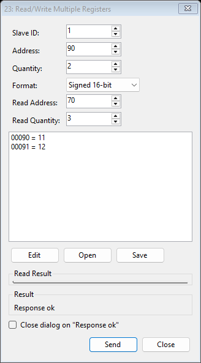

Specify separate read and write blocks in one transaction. Here the write block starts at 90 with values
`11, 12`, while the read block starts at 70 with quantity 3. The screenshot shows the request settings and
successful response status; the test also checks the readback.

</details>

### Tags, scaling and alarms

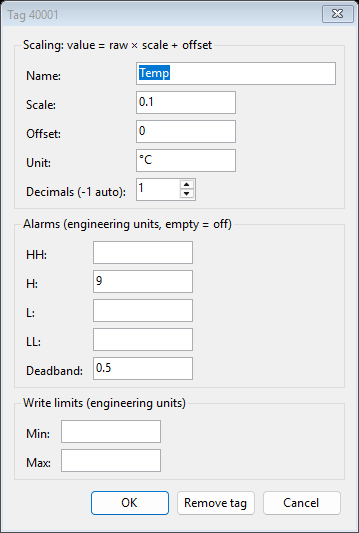

The tag editor converts raw registers using `value = raw × scale + offset`. This example names the value
`Temp`, scales it by `0.1`, adds `°C`, displays one decimal place, and sets a high threshold of `9` with
deadband `0.5`. Optional write limits use engineering units. Tag maps can be exported and imported as CSV.

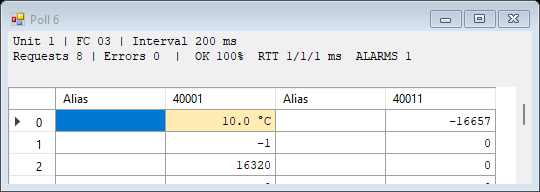

At `10.0 °C`, the cell is highlighted and the window reports `ALARMS 1`.

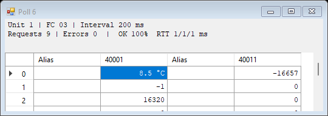

After a simulator-only write changes the value to `8.5 °C`, the highlight and alarm count clear.
The smoke test checks both transitions in alarm history. The native alarm-history message box itself is not pictured.

### Logging

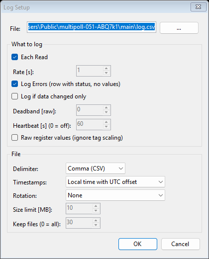

Choose which samples to log, the delimiter and timestamp convention. This example records each read and
error status to CSV using local time with a UTC offset. The same dialog offers change-only logging,
deadband, heartbeat, raw values and file rotation. The capture is configuration evidence; the test separately
checks the generated CSV header and rows.

### Interpret As

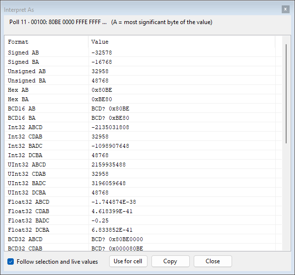

Compare the selected raw registers as signed/unsigned integers, hexadecimal, floating point and other formats.
Byte-order variants appear together. **Follow selection and live values** refreshes the comparison;
**Use for cell** applies the selected interpretation without writing to the device.

### Documents, workspaces and independent connections

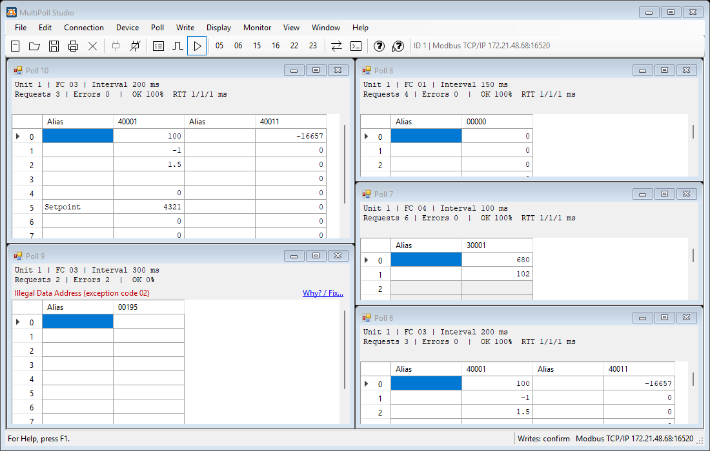

Save one polling document as `.mpoll`, or a collection of windows as `.mpollw`. This screenshot follows a
workspace save/reload and shows restored aliases, formats and read definitions. One deliberately invalid
range still reports its own error while other windows keep polling.

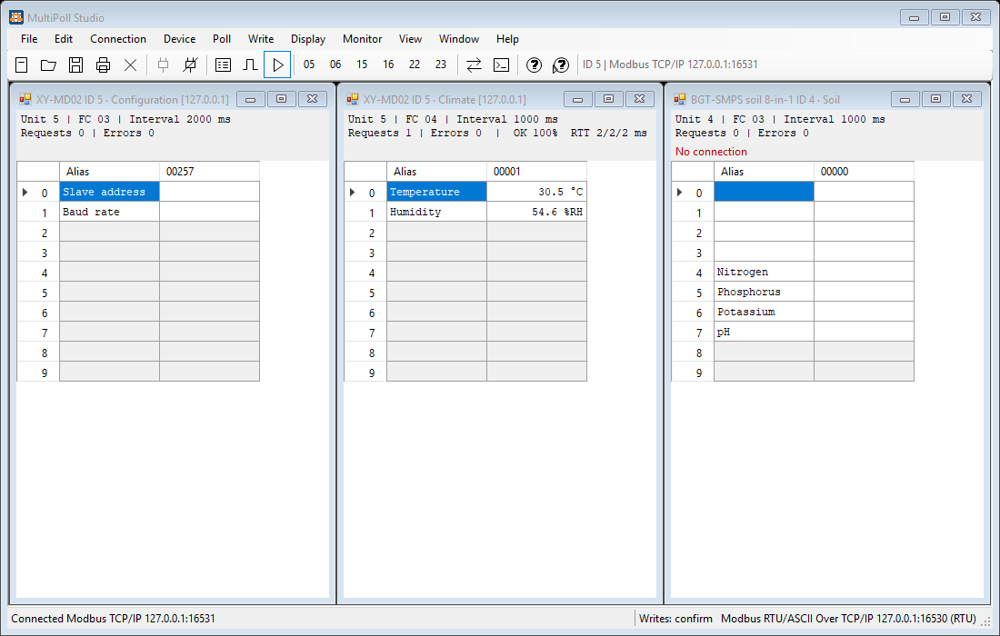

Windows may use the main connection or their own connection. After reload, the XY-MD02 climate window
is receiving data on its own TCP connection while the BGT-SMPS window has no connection. This is expected
state in the test, not a claim that all windows are connected.

The gallery covers the major feature areas, not every option, data-type combination or native Windows
file/print dialog. Hardware commissioning, printing and vendor-device compatibility are not demonstrated.
See the [Windows guide](openpoll-win/README.md) for additional controls and limitations.

## Build and try it

**Windows edition:** from WSL, with Visual Studio's Roslyn compiler and Python 3 available:

```sh
cd openpoll-win
./build.sh                 # produces dist/MultiPollStudio.exe
python3 tools/device_sim.py --host 127.0.0.1 --port 5030
```

Run the built EXE from a local Windows folder. In a separate window, connect to `127.0.0.1:5030`
using RTU over TCP; the simulator also provides Modbus TCP on port `5031`. Its devices are simulations.
The executable requires .NET Framework 4.8. Build details and simulator limitations are in the
[Windows guide](openpoll-win/README.md).

**Python edition:** from the repository root, in an existing Python environment:

```sh
cd openpoll
python -m pip install -e '.[gui,test]'
python -m pytest
multipoll-studio
```

The Python GUI needs PySide6; the core/CLI also needs pyserial. For example, a read from the simulator's
Modbus TCP endpoint is `multipoll-studio read --tcp 127.0.0.1 -p 5031 -s 5 -f 4 -a 1 -n 2`.

## Compatibility and provenance

The Windows and Python editions use the same `.mpoll` / `.mpollw` document identifiers, but the Python
edition does not support every Windows-specific display format or feature. Previous OpenPoll settings and
file identifiers are not imported automatically. See [NOTICE.md](NOTICE.md) for development history,
trademarks and device profile provenance; the static research does not constitute legal clearance.

## License and contribution

GPL-3.0-or-later: see [LICENSE](LICENSE). Contributions: [CONTRIBUTING.md](CONTRIBUTING.md) and
[CODE_OF_CONDUCT.md](CODE_OF_CONDUCT.md). For vulnerability reporting, see [SECURITY.md](SECURITY.md).
