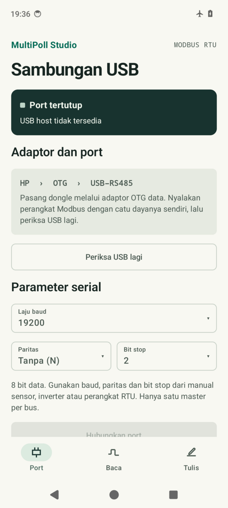
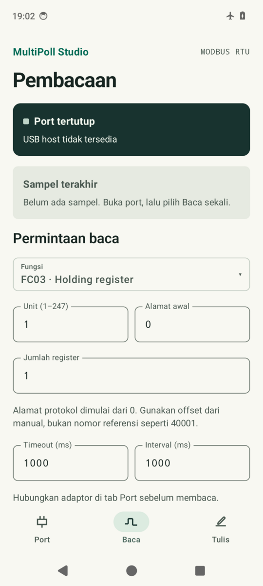
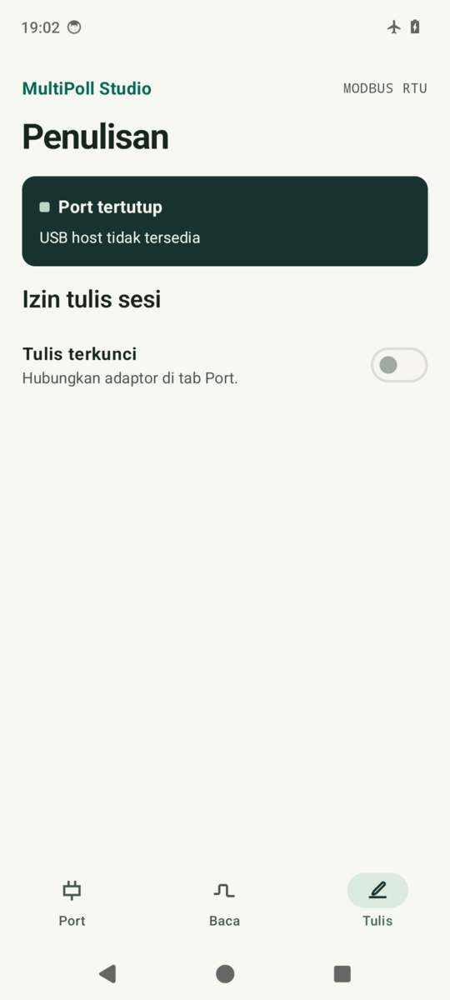

# MultiPoll Field · Android

Edisi lapangan MultiPoll Studio untuk satu bus Modbus RTU melalui USB. Antarmuka berbahasa Indonesia, bukan port tampilan desktop. Windows dan Python tetap dapat dibangun secara terpisah. APK pilot ini bukan rilis produksi; belum ada kombinasi HP dan dongle yang dinyatakan lulus uji fisik.

## Tampilan Android

Tangkapan layar dari emulator Android 14 tanpa dongle. Ketiadaan sampel dan kunci tulis adalah keadaan aplikasi sebenarnya, bukan simulasi pembacaan sensor.

| Port | Baca | Tulis |
|---|---|---|
|  |  |  |

## Mulai

1. Gunakan Android 8 (API 26) atau lebih baru dengan dukungan USB **host**, adaptor USB-C OTG **data** ke USB-A, dan konverter USB–RS485 dengan arah TX/RX otomatis. USB 2.0 maupun 3.0 dapat digunakan sepanjang seluruh jalur mendukung data dan host. Pastikan catu, polaritas, dan isolasi sesuai manual perangkat. Putuskan master lain lebih dahulu.
2. Pada tab **Port**, pilih dongle dan atur baud, paritas serta stop bit sesuai manual perangkat. Sambungkan dan izinkan akses USB saat Android meminta. Sensor, inverter/VFD, meter dan PLC tidak memerlukan profil merek: perangkat harus berperan sebagai server Modbus RTU serial dan mendukung fungsi yang dipilih. Konektor RS485 saja tidak menjamin protokolnya Modbus.
3. Pada **Baca**, masukkan alamat protokol berbasis nol (bukan label PLC seperti 40001), unit dan jumlah. Mulai dari satu kali baca sebelum polling. FC01/02 membaca bit; FC03/04 membaca register 16-bit mentah. Timeout bukan nilai nol.
4. **Tulis** hanya untuk bench yang diizinkan. Pastikan target dan nilai pada konfirmasi sebelum mengirim FC05/06. Respons echo saja tidak membuktikan output berubah. Verifikasi lewat baca ulang dan indikator perangkat. Jika kabel terlepas setelah TX, perlakukan hasil sebagai tidak diketahui; jangan kirim ulang tanpa memeriksa perangkat.
   Untuk inverter, mulai dari satu register monitor **baca-saja** yang tercantum pada manual model dan firmware tersebut. Cocokkan FC03/FC04, offset, panjang, urutan word dan faktor skala; angka mentah bukan otomatis Hz atau rpm. Jangan menguji sambungan dengan menulis RUN/STOP, arah, atau setpoint. Aplikasi bukan pengganti interlock atau fungsi keselamatan.
5. Cabut kabel atau tinggalkan aplikasi untuk menutup sesi. Hubungkan lagi secara eksplisit. Aplikasi tidak memerlukan root, internet, atau polling latar belakang. Tidak ada transport TCP/UDP/ASCII pada edisi ini.

## Build dan instalasi lokal

Prasyarat: Android SDK Platform 36, build-tools yang diminta Android Gradle Plugin, JDK 17 atau 21, dan akses ke Google Maven, Maven Central, Gradle dan JitPack saat build pertama. Dari `android/`:

```sh
./gradlew :app:testDebugUnitTest :app:assembleDebug
adb install -r app/build/outputs/apk/debug/app-debug.apk
```

Di Windows gunakan `gradlew.bat`. APK debug memakai kunci pengembangan lokal; untuk distribusi gunakan proses signing organisasi, bukan kunci debug. Pasang melalui ADB nirkabel atau salin APK lebih dahulu jika port USB HP diperlukan untuk dongle.

## Diagnosis singkat

| Gejala | Pemeriksaan pertama |
|---|---|
| Dongle tidak terdeteksi | Periksa fitur host, OTG data, daya dan konektor. Catat VID:PID/driver; nama dagang tidak cukup untuk menjamin dukungan. |
| Izin ditolak atau port tidak terbuka | Tutup aplikasi serial lain, pasang kembali dongle dan pilih Connect. Jangan mengubah izin sistem. |
| Timeout atau CRC | Periksa satu master, baud/paritas/stop bit, unit, A/B, terminasi dan arah otomatis dongle. Uji terhadap slave yang diketahui. |
| Exception Modbus | Server menjawab. Periksa dukungan fungsi, alamat berbasis nol dan jumlah menurut manual. |

Gate bench dan matriks kualifikasi: [rencana BMAD](../docs/bmad/android-usb-rs485.md). Simpan bukti OTG 2.0 dan 3.0 secara terpisah. Tes JVM dan emulator tidak menggantikan uji bus fisik.
