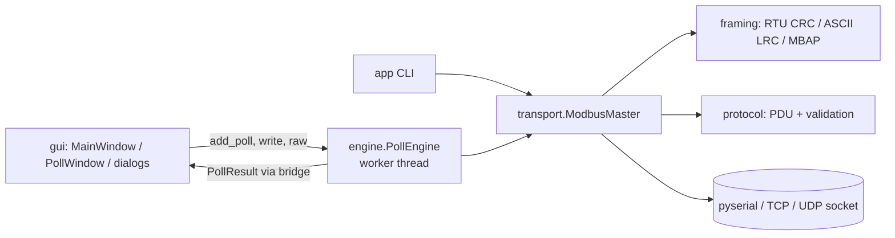

# MultiPoll Studio

An open-source Modbus client for testing and commissioning devices such as PLCs, meters and gateways.
It provides independent polling windows, serial and network connections, editable values, communication
traffic and a frame console. It runs on Linux, Windows and macOS under GPL-3.0-or-later.

The product/package is now MultiPoll Studio (`multipoll-studio`, Python module `multipoll_studio`).
Documents/workspaces use `.mpoll` / `.mpollw` and the `multipoll-document` / `multipoll-workspace` identifiers.
Old OpenPoll identifiers/settings are not imported automatically. The new toolbar and multi-connection features
are in the native Windows edition, not this Python edition.

## Features

- **Connections:** Serial RTU/ASCII, Modbus TCP, Modbus UDP, RTU/ASCII over TCP, RTU/ASCII over UDP.
  Connect/response timeout, minimum delay between polls, RTS toggle (RS-485), DSR/CTS, echo removal.
- **Reads:** 01 Coils, 02 Discrete Inputs, 03 Holding Registers, 04 Input Registers, with a per-window scan rate.
  Disabled windows can still run a single read with F6.
- **Writes:** 05, 06, 15, 16, 22 Mask Write, 23 Read/Write Multiple. You can also write by editing
  the grid: type a value or F2, and Space toggles a coil.
- **Display:** 16-bit signed/unsigned, hex, binary, 32-bit integer/float and 64-bit float, with explicit
  word-order labels; set per window or cell. PLC addresses (40001) or protocol addresses (0).
- **Diagnostics:** request/error counters, active unit, function and interval, a communication traffic window,
  and a Frame Console with CRC/LRC. Traffic lines use `000012 | TX | 01 03 …`.
- **Logging:** text log (fixed width, comma, tab), each poll or every N seconds, only on change.
- **Files:** JSON documents (`.mpoll`) and workspaces (`.mpollw`) with window layout and connection.
- **CLI** for scripting and CI, replacing the Windows-only OLE automation.

## Installation

```sh
python -m venv .venv && . .venv/bin/activate
pip install -e '.[gui]'          # GUI (PySide6) + CLI
pip install -e '.[gui,test]'     # + test dependencies
```

Requires Python ≥ 3.10. The core and the CLI need only `pyserial`.

## Usage

```sh
multipoll-studio                       # GUI
multipoll-studio plant.mpollw          # GUI with a workspace
```

| Key | Action |
|---|---|
| F3 / F4 / F5 | Connect / Disconnect / Quick connect |
| F8 | Poll Setup |
| F6 / Shift+F6 | Read once / Toggle periodic polling |
| Alt+F5..F8 | Write 05 / 06 / 15 / 16 |
| Alt+T | Frame Console |
| F11 / F12 | Error counters / Reset counters |
| Alt+L / Alt+O | Start / stop logging |

CLI:

```sh
multipoll-studio read  --tcp 192.168.1.10 -a 0 -n 10
multipoll-studio read  --tcp 192.168.1.10 -a 40001 --plc -n 4 --format float_inverse
multipoll-studio write --rtu /dev/ttyUSB0 -b 19200 --parity E -s 3 -a 100 -v 1500
multipoll-studio write --tcp 10.0.0.5 --coil -a 0 -v 1 0 1 1
multipoll-studio poll  --rtu-tcp 10.0.0.9 -p 4001 -f 4 -a 0 -n 8 --rate 500 --count 20 --trace
```

`--trace` prints Tx/Rx frames to stderr. Exit code 2 on a Modbus error or timeout.

## Architecture



One worker thread owns the connection, so requests never overlap on the bus. One-shot writes
take priority over periodic polls, and a dropped network link reconnects automatically every 2 s.

## Tests

```sh
pytest
```

The suite runs against a real pymodbus slave on loopback (TCP, UDP, RTU/ASCII over TCP) and a
serial line through a pty (RTU and ASCII via pyserial). It covers every function code, exceptions,
timeouts, CRC/LRC, display formats, PLC addressing, multi-window polling and reconnects.

## Development history

MultiPoll Studio implements the public Modbus specifications. Its development history includes a static study of
commercial software resources and documentation; this was not a formal clean-room process. Proprietary binaries,
help files and extracted resources are excluded from the project distribution. `../re/REPORT.md` records the
study; it is not a legal clearance. "Modbus Poll" is a product of Witte Software.
